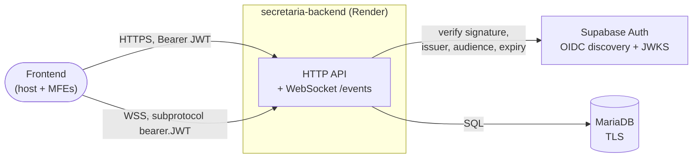
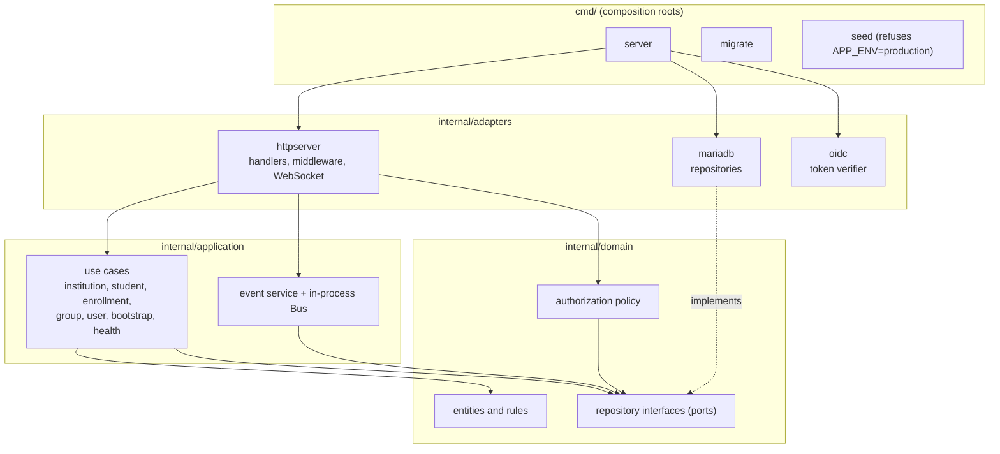
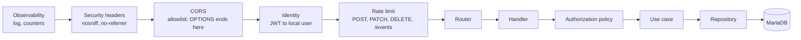
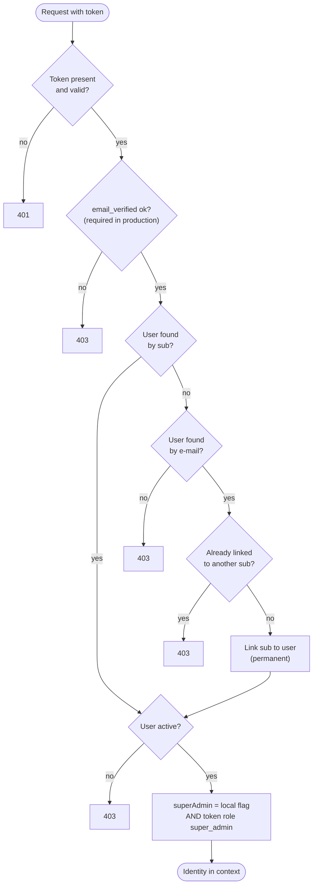
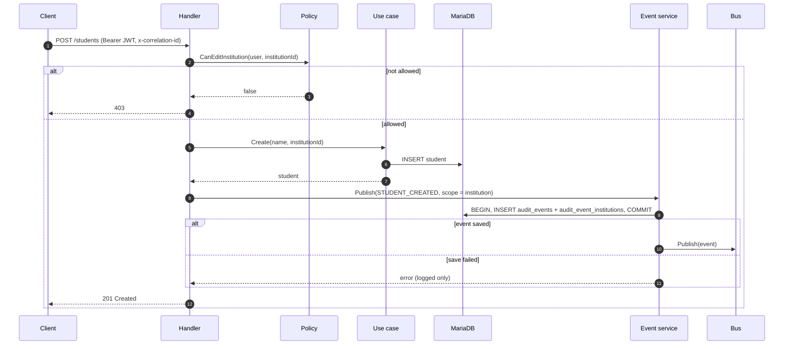
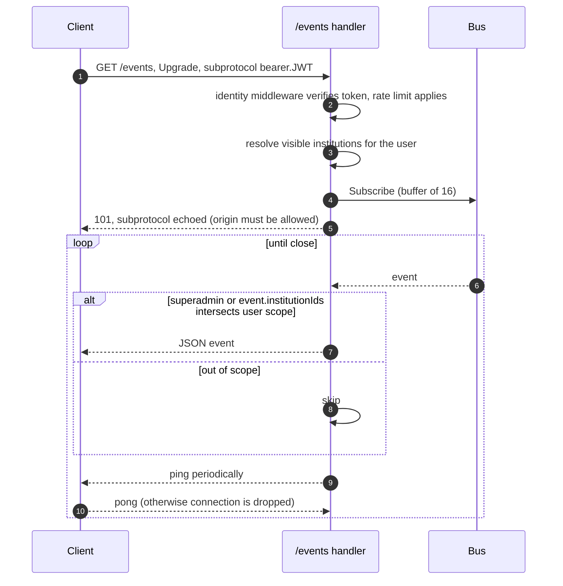
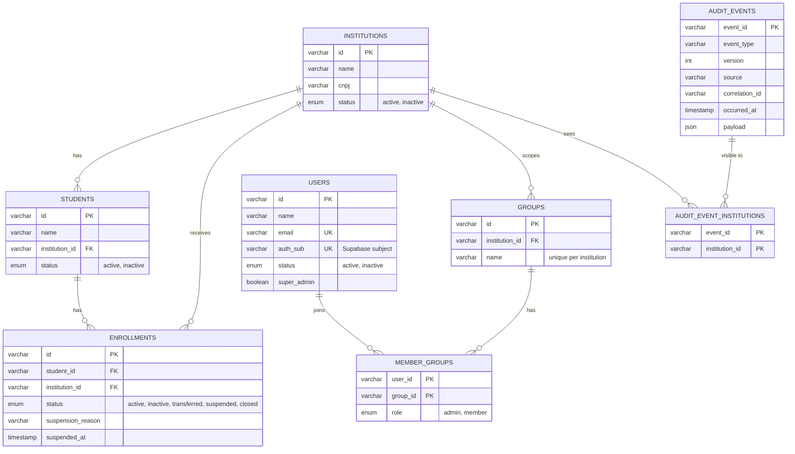
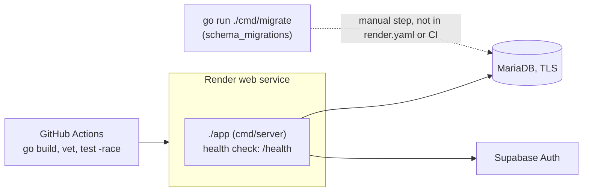

# Architecture

Diagrams for the Go API. The micro-frontends that consume it are documented in [`mfe-communication`](https://github.com/fidelis27/mfe-communication/blob/main/docs/architecture.md). The API contract is in [`openapi.yaml`](openapi.yaml).

Contents: [1. System context](#1-system-context) · [2. Layers](#2-layers-hexagonal) · [3. Request pipeline](#3-request-pipeline) · [4. Identity resolution](#4-identity-resolution) · [5. Authorization](#5-authorization) · [6. Write and publish flow](#6-write-and-publish-flow) · [7. WebSocket stream](#7-websocket-event-stream) · [8. Data model](#8-data-model) · [9. Deployment](#9-deployment) · [10. Known gaps](#10-known-gaps)

---

## 1. System context

The API never issues tokens. Supabase authenticates people; the API decides what a verified person may do, using its own users and groups tables.

---

## 2. Layers (hexagonal)

Dependencies point inward. The domain knows nothing about HTTP or SQL.

`main` only wires dependencies. Business rules live in the domain and use cases, not in SQL.

---

## 3. Request pipeline

Every request passes the same chain, outermost first. `GET /health` skips identity.

Notes that matter when debugging:

- Rate limiting sits **after** identity, so authenticated requests are limited per user and anything else per IP. Plain `GET` list routes are not limited; `GET /events` is.
- Logs carry method, path without query, status, duration and correlation ID. Never the Authorization header or a full e-mail.
- Responses for authenticated calls carry `Cache-Control: no-store`.

---

## 4. Identity resolution

How a verified token becomes a local user (ADR 0002).

Superadmin needs **both** the local flag and the Supabase role claim. E-mail is only used on first login to claim a pre-provisioned account.

---

## 5. Authorization

Rules live in `internal/domain/authorization` and handlers call them before acting. Groups belong to an institution, and a user's role is per group.

| Action | Superadmin | Group admin | Group member |
| --- | --- | --- | --- |
| Create institution, group, user; list users; read `/metrics` | yes | no | no |
| Update a user | yes | no | no |
| Create student or enrollment, transfer, suspend, reopen | yes | only for institutions where they are admin (a transfer needs both) | no |
| Manage members of a group | yes | only that group | no |
| Read institutions, students, enrollments, groups, events | all | only their institutions | only their institutions |

Guards: the last admin of a group cannot be demoted or removed (`409`); a user cannot deactivate themselves; the last active superadmin cannot be deactivated.

---

## 6. Write and publish flow

What happens on `POST /students`. Other writes follow the same shape.

The student write and the event save are **two separate transactions** (ADR 0001). The event row and its institution scope are saved together, and the broadcast happens only after that commit. If the event save fails, the client still gets `201` and the event is lost. A transactional outbox is the planned fix.

Transfers are different: closing the origin enrollment and opening the destination happen inside one transaction, and only the event is published afterwards.

---

## 7. WebSocket event stream

Limits: client frames are capped at 1 KiB, and open connections receive a close frame on graceful shutdown. The bus publish is non-blocking: if a subscriber's buffer of 16 is full, that event is skipped for that connection. Clients should use `GET /events/history` to catch up.

---

## 8. Data model

Taken from the migrations (`migrations/001` to `010`).

A student has one record and may have many enrollments over time. Event visibility is not derived from the payload: it is stored explicitly in `audit_event_institutions`.

---

## 9. Deployment

Configuration is by environment variables (`DB_*`, `OIDC_ISSUER`, `OIDC_AUDIENCE`, `CORS_ORIGINS`, `RATE_LIMIT_PER_MINUTE`, and others); see `README.pt.md` for the full table.

---

## 10. Known gaps

- **Event delivery is best effort** (section 6, ADR 0001). Fix: transactional outbox.
- **The bus is in-process.** It cannot fan out across several instances, and slow WebSocket clients can miss events (section 7).
- **Authorization is applied per handler**, not from a declarative route table (ADR 0003).
- **Some writes publish no event:** creating institutions, users and groups, and adding group members. There is also no route to update or inactivate an institution.
- **Contract drift with the frontend.** The frontend declares `INSTITUTION_CREATED`, `INSTITUTION_UPDATED`, `INSTITUTION_INACTIVATED` and `STUDENT_UPDATED`, which this API never emits. The API emits `ENROLLMENT_CREATED`, `USER_UPDATED` and `GROUP_MEMBERSHIP_*`, which the frontend contract does not list. Align the two or remove the unused types.
- **No pagination, search or idempotency keys** on list and write routes.
